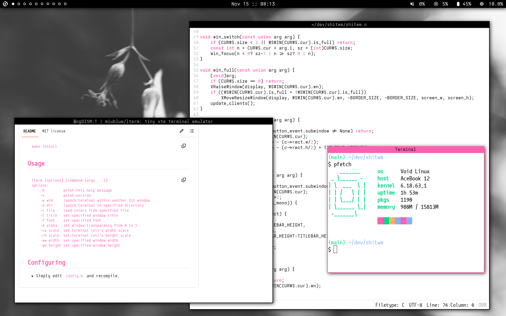

<h1 align="center">Shitwm</h1>

Tiny X11 floating window manager.

- Programs shown in the screenshot are [lbar](https://github.com/miublue/lbar),
[surf](https://surf.suckless.org), [mousepad](https://github.com/codebrainz/mousepad)
and [lterm](https://github.com/miublue/lterm).

Its code started as a branch of my other tiling window manager, [lwm](https://github.com/miublue/lwm),
but it was made into its own thing because i just felt like it.

## Installation
- Dependencies: X11, Xft.

Compile with:

    make install

## Configuration
- Simply edit `config.h` and recompile.

## Known Issues
- No support for ICCCM or EWMH.
- It doesn't keep track of drawing order, thus titlebars may be raised/lowered weirdly when switching workspaces.
- hovering a window's titlebar doesn't focus it even with `FOCUS_ON_HOVER` enabled.

